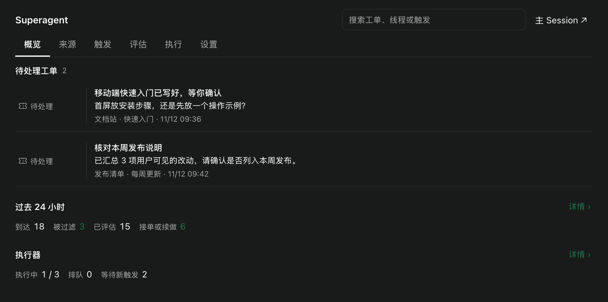
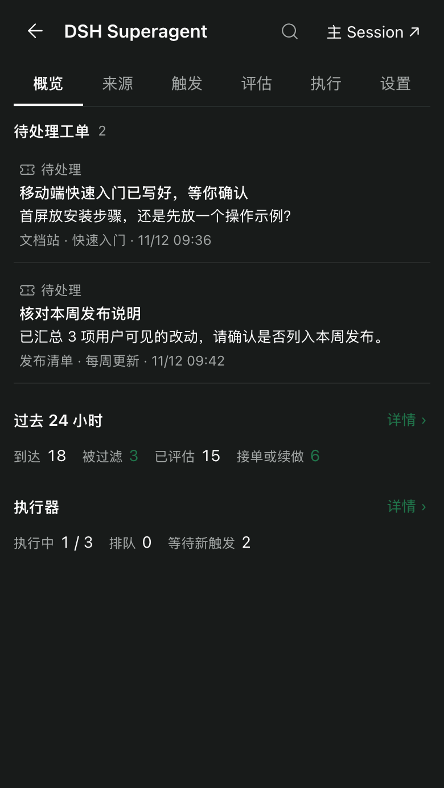
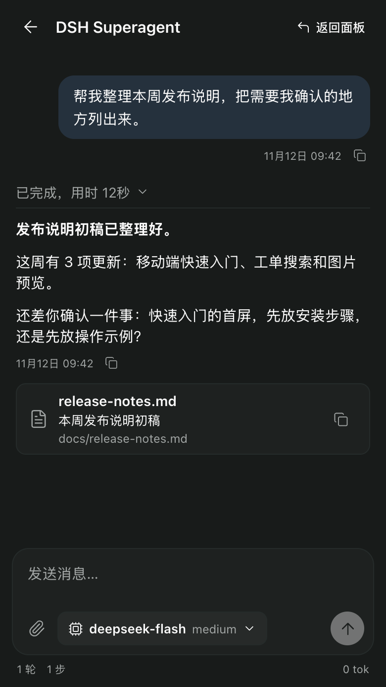

# DSH Superagent for Paseo

在电脑上给 Superagent 派任务，出门后用手机看工单，回到同一个主会话（Router）追问进度。插件装在 Paseo 主机上，由这台主机连接 DSH。手机照常连接 Paseo 即可，同机部署的 DSH 可以只监听本机端口。



## 在 Paseo 里能做什么

- **看哪些事需要你处理。** 从「概览」点开待处理工单，查看它在等谁、为什么停下。「触发」和「评估」可以追溯一条消息为什么被接单或忽略。
- **接着和 Superagent 聊。** 点右上角「主 Session」就能回到 DSH 里已有的主会话。可以发任务、切换模型、展开执行过程，也能在回复里查看图片和交付文件。
- **跟进执行，调整规则。** 在「执行」里按状态筛选工单，点开详情可以查看进展。工单支持重试或停止时，详情里会显示相应操作。「设置」里可以修改来源、评估策略、执行器和团队提示词。

<p>
  
  
</p>

截图使用示例工单和对话。桌面和手机浏览器都可以用回形针添加文件或照片。Paseo 0.17.5 的原生 iOS 和 Android 客户端可以发文字、查看已有图片，上传附件请用浏览器。

桌面版和宽屏网页的主会话跟随当前 Paseo 客户端「设置 → 聊天」里的发送偏好。默认 Enter 发送，Shift+Enter 换行。如果选择 ⌘/Ctrl+Enter 发送，单按 Enter 就能换行。使用 Enter 发送时，Router 忙碌期间按 ⌘/Ctrl+Enter 可以切换本条消息的投递方式：默认引导时改为排队，默认排队时改为引导。如果选择「中断」，插件会用 DSH 的引导模式投递消息。手机输入框保留回车换行，点箭头发送。

## 安装并连接

需要 **Paseo 0.17.5 或更高版本**，以及已安装 Superagent 的 DSH Web 实例。首次配置时，先在 DSH Web 面板完成部署检查，确认能打开主会话。[DSH Superagent 项目](https://github.com/deepseek-ai/dsh-superagent-prototype)

在运行 Paseo 的主机上安装：

```sh
paseo plugin install git:muzhi1991/paseo-dsh-superagent
```

1. 打开 **Paseo 设置 → 插件 → DSH Superagent → DSH 实例**。
2. 填写 Paseo 主机能访问的 DSH 地址，只填协议、主机名和端口。同机部署可填 `http://127.0.0.1:3083`，端口以实际为准。
3. 在 DSH 启动终端或日志中找到 `dsh web:` 登录链接，将 **`token=` 后的参数值**复制到令牌栏，点 **验证并保存**。然后从 Paseo 侧栏打开 **DSH Superagent**。

同一台 Paseo 主机只需配置一次，获准连接它的用户共享该主会话的读写权限。登录凭据保存在主机上。消息和附件会发往选定的 DSH 实例，对话内容可能由 DSH 配置的模型服务处理。

<details>
<summary>连接遇到问题？</summary>

- **使用 DeepSeek Harness Desktop**：令牌来自运行 Superagent 的 Web 实例。若只打开了桌面窗口，可用 Desktop 附带的 CLI 启动相应配置，例如 `dsh --profile superagent-dev --no-open`。请把 `superagent-dev` 换成你的 profile 名。实例已在运行时，直接看启动日志。
- **看到 HTTP 401**：DSH 没有接受当前凭据。复制该实例最近一次启动时的令牌，再点「验证并保存」。
- **DSH 在另一台机器上**：使用主机能访问的受信 HTTPS 地址，或在 Paseo 主机上做 SSH 端口转发。DSH 会校验端口，转发时请让本地端口和 DSH 监听端口一致。

</details>

<details>
<summary>本地开发</summary>

```sh
npm ci --legacy-peer-deps
npm run typecheck
npm test
paseo plugin install "$PWD"
paseo plugin reload paseo-dsh-superagent
```

</details>
